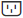
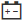

= Visualizza lo stato e le impostazioni dei componenti dello shelf in SANtricity System Manager
:allow-uri-read: 
:experimental: 
:icons: font
:imagesdir: ../media/

[role="lead"]
La pagina Hardware fornisce stato e impostazioni per i componenti dello shelf, inclusi gli alimentatori, le ventole e le batterie.

.Informazioni su questa attività
I componenti disponibili dipendono dal tipo di shelf:

* *Ripiano per unità* -- Contiene un set di unità, contenitori di alimentazione/ventole, moduli di input/output (IOMs) e altri componenti di supporto in un unico ripiano.
* *Ripiano del controller* -- Contiene un set di unità, uno o due controller canisters, power/fan canisters e altri componenti di supporto in un unico ripiano.

.Passaggi
. Seleziona *Hardware*.
. Seleziona l'elenco a discesa per il Controller Shelf o il Drive Shelf, quindi seleziona *View Settings*.
+
Si apre la finestra di dialogo Impostazioni componenti ripiano, con schede che mostrano lo stato e le impostazioni relative ai componenti del ripiano. A seconda del tipo di ripiano selezionato, alcune schede descritte nella tabella potrebbero non essere visualizzate.

+
[cols="25h,~"]
|===
| Scheda | Descrizione 

 a| 
Shelf
 a| 
La scheda *Shelf* mostra le seguenti proprietà:

** *ID scaffale* -- Identifica in modo univoco uno scaffale nell'array di archiviazione. Il firmware del controller assegna questo numero, ma puoi modificarlo selezionando menu:Scaffale[Cambia ID].
** *Shelf path redundancy* -- Specifica se le connessioni tra lo shelf e il controller dispongono di metodi alternativi (Sì) o meno (No).
** *Tipi di unità attuali* -- Mostra il tipo di tecnologia integrata nelle unità (ad esempio, un'unità SAS che supporta la sicurezza). Se sono presenti più tipi di unità, vengono visualizzate entrambe le tecnologie.
** *Numero di serie* -- Mostra il numero di serie dello shelf.

 a| 
IOM (ESM)
 a| 
La scheda *IOM (ESM)* mostra lo stato del modulo di input/output (IOM), chiamato anche modulo di servizio ambientale (ESM). Monitora lo stato dei componenti in un alloggiamento per unità e funge da punto di connessione tra l'alloggiamento delle unità e il controller.

Lo stato può essere Ottimale, Failed, Ottimale (Miswire) o Uncertified. Altre informazioni includono la versione del firmware e la versione delle impostazioni di configurazione.

Seleziona *Mostra altre impostazioni* per visualizzare le velocità di trasmissione dati massima e attuale e lo stato della comunicazione della scheda (Sì o No).

[NOTE]
====
È possibile visualizzare questo stato anche selezionando l'icona IOM image:../media/sam1130-ss-hardware-iom-icon.gif[""], accanto all'elenco a discesa Shelf.

====

 a| 
Alimentatori
 a| 
La scheda *Alimentatori* mostra lo stato del contenitore dell'alimentatore e dell'alimentatore stesso. Lo stato può essere Ottimale, Guasto, Rimosso o Sconosciuto. Mostra anche il numero di parte dell'alimentatore.

[NOTE]
====
È possibile visualizzare questo stato anche selezionando l'icona Alimentatore , accanto all'elenco a discesa Shelf.

====

 a| 
Ventole
 a| 
La scheda *Ventole* mostra lo stato del contenitore della ventola e della ventola stessa. Lo stato può essere Ottimale, Guasto, Rimosso o Sconosciuto.

[NOTE]
====
È possibile visualizzare questo stato anche selezionando l'icona della ventola , accanto all'elenco a discesa Shelf.

====

 a| 
Temperatura
 a| 
La scheda *Temperatura* mostra lo stato della temperatura dei componenti del ripiano, come i sensori, i controller e le unità di alimentazione/ventilazione. Lo stato può essere Ottimale, Temperatura nominale superata, Temperatura massima superata o Sconosciuto.

[NOTE]
====
È possibile visualizzare questo stato anche selezionando l'icona Temperatura , accanto all'elenco a discesa Shelf.

====

 a| 
Batterie
 a| 
La scheda *Batterie* mostra lo stato delle batterie del controller. Lo stato può essere Ottimale, Guasta, Rimossa o Sconosciuto. Altre informazioni includono l'età della batteria, i giorni rimanenti prima della sostituzione, i cicli di apprendimento e le settimane tra un ciclo di apprendimento e l'altro.

[NOTE]
====
È possibile visualizzare questo stato anche selezionando l'icona Batterie , accanto all'elenco a discesa Shelf.

====

 a| 
SFP
 a| 
La scheda *SFP* mostra lo stato dei ricetrasmettitori Small Form-factor Pluggable (SFP) sui controller. Lo stato può essere Ottimale, Non riuscito o Sconosciuto.

Seleziona *Mostra altre impostazioni* per visualizzare il part number, il numero di serie e il vendor degli SFP.

[NOTE]
====
È possibile visualizzare questo stato anche selezionando l'icona SFP , accanto all'elenco a discesa Shelf.

====
|===
. Fare clic su *Close*.

