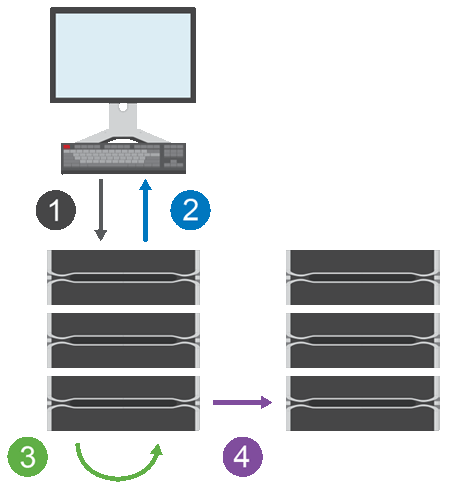

= Come funziona il mirroring asincrono in SANtricity System Manager
:allow-uri-read: 
:icons: font
:imagesdir: ../media/

[role="lead"]
Il mirroring asincrono copia i volumi di dati su richiesta o secondo una pianificazione, riducendo al minimo o evitando i tempi di inattività che potrebbero derivare da danneggiamento o perdita di dati.

La replica asincrona cattura lo stato del volume primario in un determinato momento e copia solo i dati che sono cambiati dall'ultima acquisizione dell'immagine. Il sito primario può essere aggiornato immediatamente e il sito secondario può essere aggiornato man mano che la larghezza di banda lo consente. Le informazioni vengono memorizzate nella cache e inviate in un secondo momento, non appena le risorse di rete diventano disponibili.

Questo tipo di mirroring è ideale per soddisfare la domanda di operazioni non-stop e, in generale, è molto più efficiente in termini di rete per processi periodici, come copia di backup e archiviazione. I motivi per utilizzare il mirroring asincrono includono i seguenti:

* Consolidamento dei backup remoti.
* Proteggi da disastri locali o su vasta scala.
* Sviluppo e test di applicazioni su un'immagine point-in-time di dati live.

[[asynchronous-mirroring-session]]
== Sessione di mirroring asincrono

Il mirroring asincrono cattura lo stato del volume primario in un determinato momento e copia solo i dati che sono cambiati dall'ultima acquisizione dell'immagine. Il mirroring asincrono consente di aggiornare immediatamente il sito primario e di aggiornare il sito secondario man mano che la larghezza di banda lo consente. Le informazioni vengono memorizzate nella cache e inviate in un secondo momento, quando le risorse di rete diventano disponibili.

Ci sono quattro fasi principali in una sessione di mirroring asincrono attiva.

. Un'operazione di scrittura avviene innanzitutto sull'array di archiviazione del volume primario.
. Lo stato dell'operazione viene restituito all'host.
. Tutte le modifiche sul volume primario vengono registrate e tracciate.
. Tutte le modifiche vengono inviate all'array di archiviazione del volume secondario come processo in background.

Questi passaggi vengono ripetuti secondo gli intervalli di sincronizzazione definiti o i passaggi possono essere ripetuti manualmente se non sono definiti intervalli.

Il mirroring asincrono trasferisce i dati al sito remoto solo a intervalli prestabiliti, quindi l'I/O locale non risente quasi per niente delle connessioni di rete lente. Poiché questo trasferimento non è vincolato all'I/O locale, non influisce sulle prestazioni dell'applicazione. Pertanto, il mirroring asincrono può utilizzare connessioni più lente, come iSCSI, e funzionare su distanze maggiori tra i sistemi di storage locali e remoti.

Gli array di storage devono avere una versione minima del firmware pari a 7.84. (Possono ciascuno eseguire versioni diverse del sistema operativo.)

[[mirror-consistency-groups-and-mirrored-pairs]]
== Gruppi di coerenza mirror e coppie mirror

Si crea un gruppo di coerenza mirror per stabilire la relazione di mirroring tra l'array di storage locale e l'array di storage remoto. La relazione di mirroring asincrono consiste in una coppia mirror: un volume primario su un array di storage e un volume secondario su un altro array di storage.

L'array di storage contenente il volume primario si trova solitamente nel sito primario e serve gli host attivi. L'array di storage contenente il volume secondario si trova solitamente in un sito secondario e ospita una replica dei dati. Il volume secondario in genere contiene una copia di backup dei dati e viene utilizzato per il ripristino di emergenza.

[[synchronization-settings]]
== Impostazioni di sincronizzazione

Quando si crea una coppia speculare, si definiscono anche la priorità di sincronizzazione e la politica di risincronizzazione che la coppia speculare utilizza per completare l'operazione di risincronizzazione dopo un'interruzione della comunicazione.

Quando si crea un gruppo di coerenza mirror, si definiscono anche la priorità di sincronizzazione e la politica di risincronizzazione per tutte le coppie mirror all'interno del gruppo. Le coppie mirror utilizzano la priorità di sincronizzazione e la politica di risincronizzazione per completare l'operazione di risincronizzazione dopo un'interruzione della comunicazione.

In una coppia con mirroring, i volumi primario e secondario possono desincronizzarsi quando l'array di storage del volume primario non è in grado di scrivere dati sul volume secondario. Questa condizione può essere causata dai seguenti problemi:

* Problemi di rete tra gli array di archiviazione locali e remoti.
* Un volume secondario non riuscito.
* La sincronizzazione viene sospesa manualmente sulla coppia mirrorata.
* Conflitto di ruolo del gruppo mirror.

È possibile sincronizzare i dati sull'array di storage remoto manualmente o automaticamente.

[[reserved-capacity-and-asynchronous-mirroring]]
== Capacità riservata e mirroring asincrono

La capacità riservata viene utilizzata per tenere traccia delle differenze tra il volume primario e il volume secondario quando la sincronizzazione non è in corso. Inoltre, tiene traccia delle statistiche di sincronizzazione per ciascuna coppia di volumi mirrorati.

Ogni volume in una coppia con mirroring richiede la propria capacità riservata.

[[configuration-and-management]]
== Configurazione e gestione

Per abilitare e configurare il mirroring tra due array, è necessario utilizzare l'interfaccia di Unified Manager. Una volta abilitato il mirroring, è possibile gestire le coppie mirrorate e le impostazioni di sincronizzazione in System Manager.
