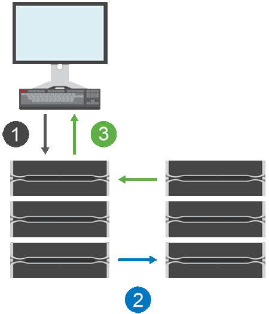

= Come funziona il mirroring sincrono in SANtricity System Manager
:allow-uri-read: 
:icons: font
:imagesdir: ../media/

[role="lead"]
Il mirroring sincrono replica i volumi di dati in tempo reale per garantire disponibilità continua.

[NOTE]
====
La funzione di mirroring sincrono non è disponibile sull'array di storage EF600/EF600C o EF300/EF300C.

====
Il mirroring sincrono raggiunge un recovery point objective (RPO) di zero dati persi avendo una copia dei dati importanti disponibile se si verifica un disastro su uno dei due storage array. La copia è identica ai dati di produzione in ogni momento perché ogni volta che viene eseguita una scrittura sul volume primario, viene eseguita una scrittura anche sul volume secondario. L'host non riceve una conferma che la scrittura è stata eseguita con successo finché il volume secondario non viene aggiornato correttamente con le modifiche apportate al volume primario.

Questo tipo di mirroring è ideale per scopi di continuità operativa, come il disaster recovery.

[[synchronous-mirroring-relationship]]
== Relazione di mirroring sincrono

Una relazione di mirroring sincrono consiste in un volume primario e un volume secondario su array di storage separati. L'array di storage contenente il volume primario si trova solitamente presso il sito primario e serve gli host attivi. L'array di storage contenente il volume secondario si trova solitamente presso un sito secondario e contiene una replica dei dati. Il volume secondario viene utilizzato se l'array di storage del volume primario non è disponibile a causa, ad esempio, di un'interruzione completa di corrente, di un incendio o di un guasto hardware presso il sito primario.

[[synchronous-mirroring-session]]
== Sessione di mirroring sincrono

Il processo di configurazione del mirroring sincrono prevede la configurazione di volumi in coppie. Dopo aver creato una coppia con mirroring, composta da un volume primario su un array di storage e un volume secondario su un altro array di storage, è possibile avviare il mirroring sincrono. I passaggi del mirroring sincrono sono illustrati di seguito.

. Arriva una scrittura dall'host.
. L'operazione di scrittura viene confermata sul volume primario, propagata al sistema remoto e quindi confermata sul volume secondario.
. L'array di storage del volume primario invia un messaggio di completamento I/O al sistema host _dopo_ che entrambe le operazioni di scrittura sono state completate con successo.

La capacità riservata viene utilizzata per registrare informazioni sulla richiesta di scrittura in arrivo da un host.

Quando il controller proprietario corrente del volume primario riceve una richiesta di scrittura da un host, il controller registra prima le informazioni sulla scrittura nella capacità riservata del volume primario. Poi scrive i dati sul volume primario. Successivamente, il controller avvia un'operazione di scrittura remota per copiare i blocchi di dati interessati sul volume secondario nell'array di storage remoto.

Poiché l'applicazione host deve attendere che la scrittura avvenga sull'array di storage locale e attraverso la rete sull'array di storage remoto, è necessaria una connessione molto veloce tra l'array di storage locale e l'array di storage remoto per mantenere la relazione di mirroring senza ridurre eccessivamente le prestazioni di I/O locali.

[[disaster-recovery]]
== Disaster recovery

Il mirroring sincrono mantiene una copia dei dati che è fisicamente distante dal sito in cui risiedono i dati. Se si verifica un disastro presso il sito primario, come un'interruzione di corrente o un'alluvione, i dati possono essere rapidamente accessibili dal sito secondario.

Il volume secondario non è disponibile per le applicazioni host mentre l'operazione di mirroring sincrono è in corso, quindi, in caso di disastro nell'array di storage locale, è possibile eseguire il failover sull'array di storage remoto. Per eseguire il failover, promuovere il volume secondario al ruolo primario. Quindi l'host di ripristino può accedere al volume appena promosso e le operazioni di business possono continuare.

[[synchronization-settings]]
== Impostazioni di sincronizzazione

Quando si crea una coppia speculare, si definiscono anche la priorità di sincronizzazione e la politica di risincronizzazione che la coppia speculare utilizza per completare l'operazione di risincronizzazione dopo un'interruzione della comunicazione.

Se il collegamento di comunicazione tra i due array di storage smette di funzionare, gli host continuano a ricevere conferme dall'array di storage locale, evitando una perdita di accesso. Quando il collegamento di comunicazione torna a funzionare, eventuali dati non replicati possono essere risincronizzati automaticamente o manualmente con l'array di storage remoto.

Se la risincronizzazione dei dati avviene automaticamente dipende dalla policy di risincronizzazione della coppia mirror. Una policy di risincronizzazione automatica consente alla coppia mirror di risincronizzarsi automaticamente quando il collegamento torna a funzionare. Una policy di risincronizzazione manuale richiede di riprendere manualmente la sincronizzazione dopo un problema di comunicazione. La risincronizzazione manuale è la policy consigliata.

È possibile modificare le impostazioni di sincronizzazione per una coppia con mirroring solo sull'array di storage che contiene il volume primario.

[[unsynchronized-data]]
== Dati non sincronizzati

I volumi primario e secondario si desincronizzano quando l'array di storage del volume primario non è in grado di scrivere dati sul volume secondario. Ciò può essere causato dai seguenti problemi:

* Problemi di rete tra gli array di storage locali e remoti
* Un volume secondario non riuscito
* Sincronizzazione sospesa manualmente sulla coppia mirrorata

[[orphaned-mirrored-pair]]
== Coppia speculare orfana

Un volume di coppia speculare orfano esiste quando un volume membro è stato rimosso da un lato (sia dal lato primario che dal lato secondario) ma non dall'altro lato.

I volumi di coppie mirrorate orfane vengono rilevati quando la comunicazione tra gli array viene ripristinata e i due lati della configurazione mirrorata riconciliano i parametri del mirror.

È possibile rimuovere una coppia mirrorata per correggere lo stato di una coppia mirrorata orfana.

[[configuration-and-management]]
== Configurazione e gestione

Per abilitare e configurare il mirroring tra due array, è necessario utilizzare l'interfaccia di Unified Manager. Una volta abilitato il mirroring, è possibile gestire le coppie mirrorate e le impostazioni di sincronizzazione in System Manager.
