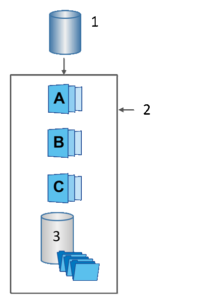

= Scopri volumi di base, capacità riservata e gruppi di snapshot in SANtricity System Manager
:allow-uri-read: 
:icons: font
:imagesdir: ../media/

[role="lead"]
La funzionalità Snapshot utilizza volumi di base, capacità riservata e gruppi di Snapshot.

== Volumi di base

Un _volume di base_ è il volume utilizzato come sorgente per un'immagine Snapshot. Un volume di base può essere un volume spesso o un volume sottile e può risiedere in un pool o in un gruppo di volumi.

Per acquisire snapshot del volume di base, è possibile creare un'immagine istantanea in qualsiasi momento oppure automatizzare il processo definendo una pianificazione regolare per le snapshot.

La figura seguente mostra la relazione tra gli oggetti Snapshot e il volume di base.

^1^ Volume base; ^2^ Oggetti Snapshot nel gruppo (immagini e capacità riservata); ^3^ Capacità riservata per il gruppo Snapshot.

== Capacità riservata e gruppi di Snapshot

System Manager organizza le immagini snapshot in _gruppi di snapshot_. Quando System Manager stabilisce il gruppo di snapshot, crea automaticamente la _capacità riservata_ associata per contenere le immagini snapshot del gruppo e per tenere traccia delle modifiche successive agli snapshot aggiuntivi.

Se il volume base si trova in un gruppo di volumi, la capacità riservata può essere collocata in un pool o in un gruppo di volumi. Se il volume base si trova in un pool, la capacità riservata deve essere collocata nello stesso pool del volume base.

I gruppi di Snapshot non richiedono alcuna azione da parte dell'utente, ma è possibile modificare la capacità riservata su un gruppo di Snapshot in qualsiasi momento. Inoltre, potrebbe essere richiesto di creare capacità riservata quando vengono soddisfatte le seguenti condizioni:

* Ogni volta che si crea uno snapshot di un volume di base che non dispone ancora di un gruppo di snapshot, System Manager crea automaticamente un gruppo di snapshot. Questa operazione crea anche capacità riservata per il volume di base, utilizzata per archiviare le immagini snapshot successive.
* Ogni volta che si crea una pianificazione di snapshot per un volume di base, System Manager crea automaticamente un gruppo di snapshot.

== Eliminazione automatica

Quando si lavora con gli snapshot, utilizzare l'opzione predefinita per avere l'eliminazione automatica attivata. L'eliminazione automatica cancella automaticamente l'immagine snapshot più vecchia quando il gruppo di snapshot raggiunge il limite di 32 immagini. Se si disattiva l'eliminazione automatica, i limiti del gruppo di snapshot verranno eventualmente superati e sarà necessario intervenire manualmente per configurare le impostazioni del gruppo di snapshot e gestire la capacità riservata.
