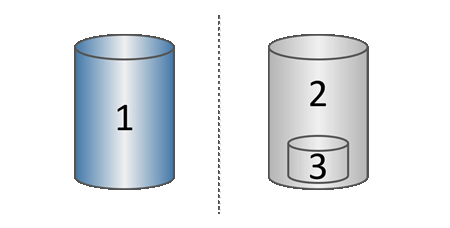

= Come funziona l'archiviazione degli Snapshot nel software SANtricity
:allow-uri-read: 
:icons: font
:imagesdir: ../media/

[role="lead"]
La funzione Snapshot utilizza la tecnologia copy-on-write per memorizzare le immagini snapshot e utilizzare la capacità riservata allocata.

[[how-snapshot-images-are-used]]
== Come vengono utilizzate le immagini Snapshot

Un'immagine Snapshot è una copia logica di sola lettura del contenuto di un volume, acquisita in un determinato point-in-time. Puoi utilizzare le Snapshot per proteggere dalla perdita di dati.

Le immagini Snapshot sono utili anche per gli ambienti di test. Creando una copia virtuale dei dati, è possibile testare i dati utilizzando lo snapshot senza modificare il volume effettivo. Inoltre, gli host non hanno accesso in scrittura alle immagini Snapshot, quindi i tuoi snapshot sono sempre una risorsa di backup sicura.

[[snapshot-creation]]
== Creazione di Snapshot

Quando vengono create le Snapshot, la funzione Snapshot memorizza i dati dell'immagine come segue:

* Quando viene creata un'immagine Snapshot, questa corrisponde esattamente al volume di base. La funzione Snapshots utilizza tecnologia copy-on-write. Dopo la creazione dello Snapshot, la prima scrittura su un blocco o un insieme di blocchi del volume di base comporta la copia dei dati originali nella capacità riservata prima della scrittura dei nuovi dati sul volume di base.
* Le Snapshot successive includono solo i blocchi di dati modificati. Prima che i dati vengano sovrascritti sul volume di base, la funzione Snapshot utilizza la tecnologia copy-on-write per salvare le immagini necessarie dei settori interessati nella capacità riservata alle Snapshot.
+

^1^ Volume base (capacità del disco fisico); ^2^ Snapshots (capacità del disco logico); ^3^ Capacità riservata (capacità del disco fisico)

* La capacità riservata memorizza i blocchi di dati originali per le porzioni del volume di base che sono state modificate dopo la creazione dello snapshot e include un indice per tenere traccia delle modifiche. In genere, la dimensione della capacità riservata è predefinita al 40 percento del volume di base. (Se hai bisogno di una maggiore capacità riservata, puoi aumentare la capacità riservata.)
* Le immagini Snapshot vengono memorizzate in un ordine specifico, in base alla loro data e ora. Solo l'immagine Snapshot più vecchia di un volume di base è disponibile per la cancellazione manuale.

[[snapshot-restoration]]
== Ripristino Snapshot

Per ripristinare i dati su un volume di base, puoi utilizzare un volume Snapshot o un'immagine Snapshot:

* *Snapshot volume* -- Se devi recuperare file eliminati, crea un volume snapshot da un'immagine snapshot valida e assegnalo all'host.
* *Snapshot image* -- Se è necessario ripristinare un volume di base a un point-in-time, utilizzare un'immagine snapshot precedente per ripristinare i dati sul volume di base.

