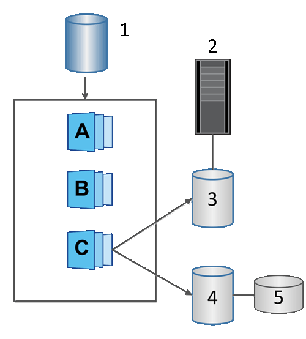

= Scopri i volumi Snapshot nel software SANtricity
:allow-uri-read: 
:icons: font
:imagesdir: ../media/

[role="lead"]
È possibile creare un volume Snapshot e assegnarlo a un host se si desidera leggere o scrivere dati Snapshot. Il volume Snapshot condivide le stesse caratteristiche del volume base (livello RAID, caratteristiche di I/O e così via).

Quando si crea un volume Snapshot, è possibile designarlo come __di sola lettura__ o _accessibile in lettura e scrittura_.

Quando si creano volumi Snapshot di sola lettura, non è necessario aggiungere capacità riservata. Quando si creano volumi Snapshot di lettura/scrittura, è necessario aggiungere capacità riservata per fornire l'accesso in scrittura.

^1^ Volume base; ^2^ Host; ^3^ Volume Snapshot di sola lettura; ^4^ Volume Snapshot di lettura/scrittura; ^5^ Capacità riservata
