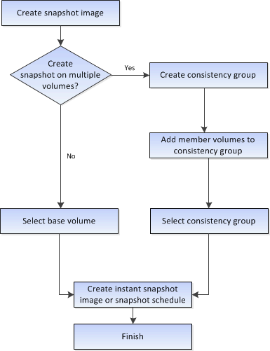

= Come funziona la creazione di immagini Snapshot e volumi Snapshot in SANtricity System Manager
:allow-uri-read: 
:icons: font
:imagesdir: ../media/

[role="lead"]
In SANtricity System Manager, puoi creare immagini Snapshot e volumi Snapshot seguendo questi passaggi.

[[workflow-for-creating-snapshot-images]]
== Flusso di lavoro per la creazione di immagini Snapshot

[[workflow-for-creating-snapshot-volumes]]
== Flusso di lavoro per la creazione di volumi Snapshot

image::../media/sam1130-flw-snapshots-create-ss-volumes.gif[Flusso di lavoro per la creazione di volumi Snapshot]
