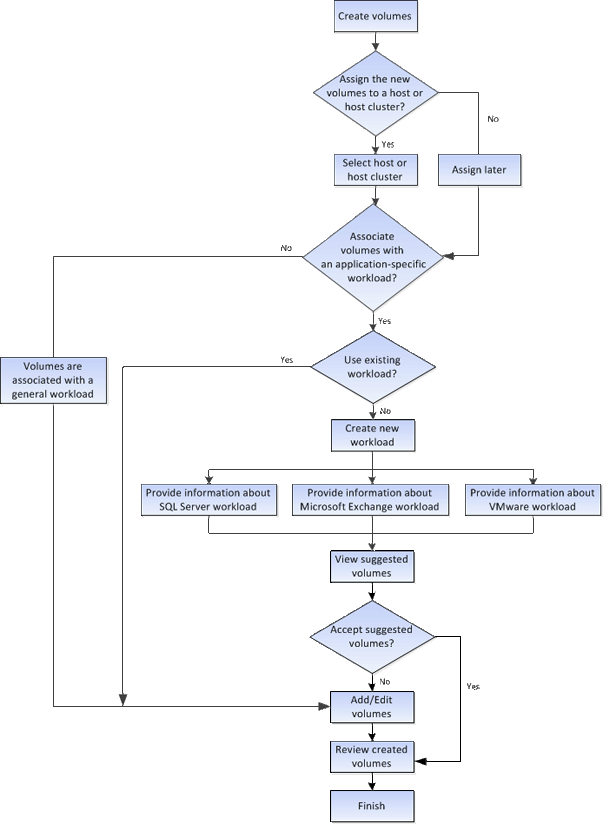

= Come funziona la creazione di volumi in SANtricity System Manager
:allow-uri-read: 
:icons: font
:imagesdir: ../media/

[role="lead"]
In SANtricity System Manager, puoi creare volumi seguendo questi passaggi.

