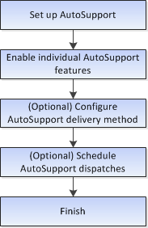

= Configura AutoSupport in SANtricity System Manager
:allow-uri-read: 
:icons: font
:imagesdir: ../media/

[role="lead"]
In SANtricity System Manager, configuri la funzionalità AutoSupport seguendo questi passaggi.

