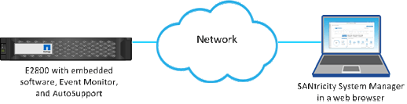

= Scopri come accedere a SANtricity System Manager da Unified Manager
:allow-uri-read: 
:icons: font
:imagesdir: ../media/

[role="lead"]
Selezionare uno o più array di storage e utilizzare l'opzione Avvia per aprire SANtricity System Manager quando si desidera configurare e gestire gli array di storage.

System Manager è un'applicazione integrata nei controller, connessa alla rete tramite una porta di gestione Ethernet. Include tutte le funzioni basate sull'array.

Per accedere a System Manager, è necessario disporre di:

* Uno dei modelli di array elencati qui: link:https://docs.netapp.com/us-en/e-series/getting-started/learn-hardware-concept.html["Panoramica hardware E-Series"^]
* Una connessione fuori banda a un client di gestione di rete con un browser web.

